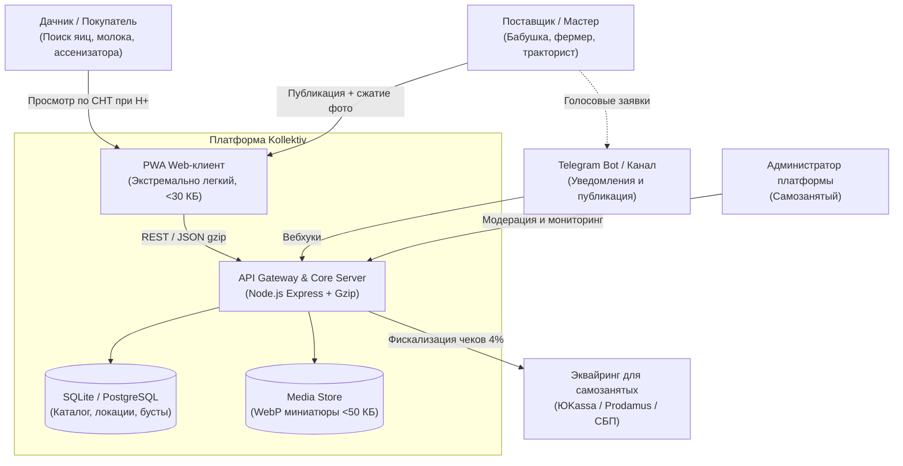

# 🏛️ Архитектура платформы «Kollektiv» (System Design)

## 1. Контекстная C4-модель (System Context)



---

## 2. Бюджет производительности под мобильные сети H+ / 3G

В условиях дачных массивов типичные характеристики сети HSPA+:
- Пропускная способность: от 100 кбит/с до 1 Мбит/с.
- Задержка (RTT): 200 – 800 мс (высокий jitter).
- Потеря пакетов: до 5–15% при перемещении между базовыми станциями.

### Меры по обеспечению мгновенного отклика:
1. **Нулевой фреймворковый оверхед**:
   - Никаких React / Angular / Vue библиотек в клиенте.
   - Чистый HTML5 + Vanilla JS + инлайн-стили.
   - Размер первой полезной нагрузки: **18–25 КБ** (вместо 1.5–3 МБ у Авито).
2. **Сжатие на стороне клиента (Client-Side Pre-processing)**:
   - Вход: 48-мегапиксельное фото яйца с телефона (5.8 МБ).
   - Обработка: HTML5 Canvas ресайзит до 800×600 px при `quality = 0.75`.
   - Выход: WebP файл размером **~35 КБ**.
   - Экономия сетевого трафика: **в 160 раз!**
3. **Delta Synchronization (`/api/listings?since=...`)**:
   - При повторных визитах клиент отправляет timestamp последнего успешного запроса.
   - Сервер возвращает только измененные записи. Трафик составляет **< 2 КБ**.

---

## 3. Схема данных (Data Model)

```sql
-- Локации (СНТ, поселки, деревни)
CREATE TABLE locations (
  id INTEGER PRIMARY KEY AUTOINCREMENT,
  name TEXT NOT NULL UNIQUE,
  type TEXT NOT NULL, -- 'СНТ', 'Поселок', 'Деревня'
  lat REAL,
  lon REAL
);

-- Категории
CREATE TABLE categories (
  id TEXT PRIMARY KEY,
  name TEXT NOT NULL,
  icon TEXT NOT NULL,
  type TEXT NOT NULL CHECK(type IN ('goods', 'services'))
);

-- Объявления
CREATE TABLE listings (
  id INTEGER PRIMARY KEY AUTOINCREMENT,
  title TEXT NOT NULL,
  description TEXT,
  type TEXT NOT NULL CHECK(type IN ('goods', 'services')),
  category_id TEXT NOT NULL,
  location_id INTEGER,
  location_name TEXT NOT NULL,
  address_detail TEXT,
  price INTEGER DEFAULT 0,
  price_unit TEXT DEFAULT 'руб',
  contact_name TEXT NOT NULL,
  contact_phone TEXT,
  contact_telegram TEXT,
  image_url TEXT,
  is_boosted INTEGER DEFAULT 0,
  boosted_until TEXT,
  created_at TEXT NOT NULL,
  updated_at TEXT NOT NULL
);
```

---

## 4. Дорожная карта масштабирования (Roadmap)

1. **Фаза 1 (Текущая — MVP)**:
   - Standalone-сервер Node.js с встроенным SQLite в режиме WAL.
   - Локальное файловое хранилище оптимизированных WebP фото.
   - PWA с Service Worker для оффлайн-доступа.
2. **Фаза 2 (Кластер и Геопоиск)**:
   - Миграция с SQLite на **PostgreSQL + PostGIS** для поиска по радиусу (например, `ST_DWithin(geom, ST_MakePoint(lon, lat), 5000)`).
   - Перевод медиафайлов в S3-совместимое хранилище (MinIO / Selectel).
3. **Фаза 3 (Telegram Bot & AI Voice Ingestion)**:
   - Подключение Whisper API / локального движка Vosk для приема голосовых сообщений от бабушек.
   - Автоматический парсинг текста через LLM в JSON-карточку.
